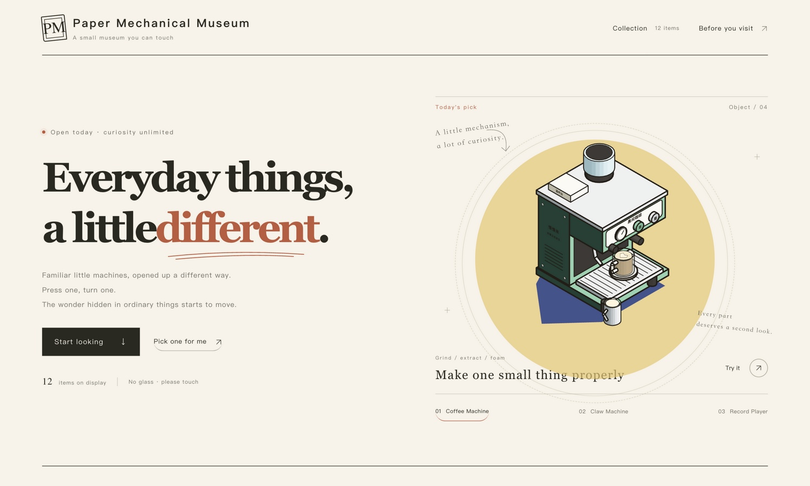
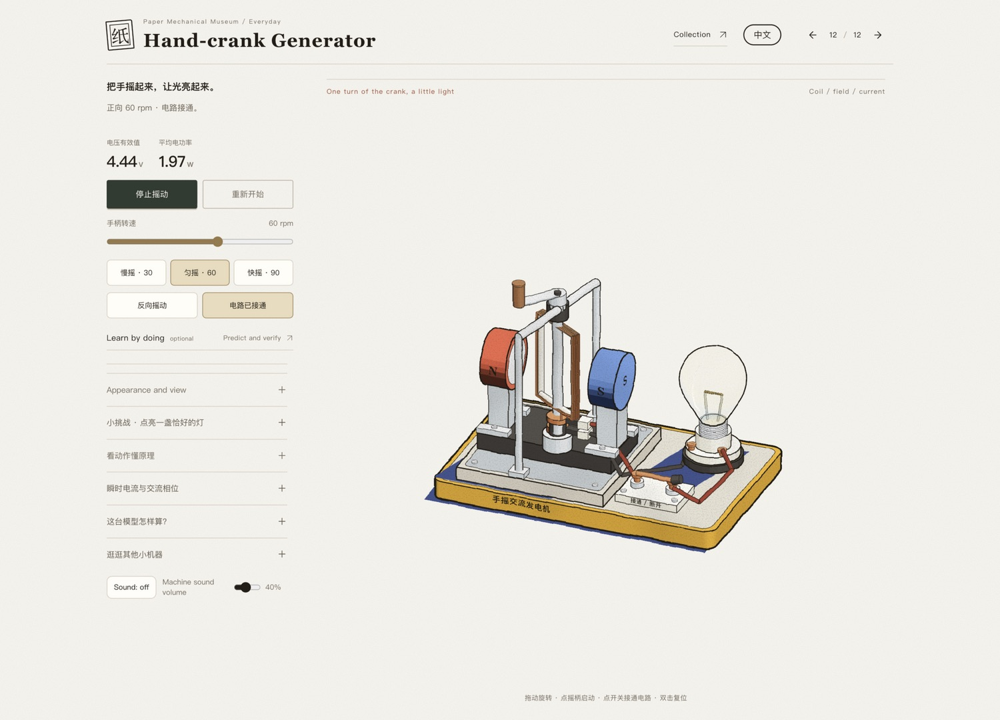

# Paper Mechanical Museum · 纸上机械馆

Twelve small everyday machines you can operate by hand. Turn, press, shift gears — and watch how motion travels and how sound happens. Paper texture, hand-drawn lines and dimensional SVG put mechanism on a single workbench.

**[Enter the museum →](https://paper-mechanical-museum.vercel.app/)** · [Development guide](docs/DEVELOPMENT.md) · [Documentation index](docs/README.md) · [Sources & attribution](THIRD_PARTY_NOTICES.md)

No account, no install — open the site and start. Free play is the default entry; guided lessons and principle observation are optional ways to explore that never operate the machines for you. Sound is off until you turn it on. These are interactive teaching models, not manufacturing drawings or simulations of real-device performance.

## Screenshots

### One workbench, twelve everyday machines



### Operate by hand, see the mechanism



Real browser screenshots of the production site, taken 2026-10-28. The generator frame was captured by operating "开始摇动" into a positive 60 rpm, circuit-closed state — it is not a concept render or a composite. A still image shows one state only; the full interaction is best experienced in the museum. [Screenshot sources and update notes](docs/screenshots/README.md).

## The collection

| Exhibit | Try this |
| --- | --- |
| [Washing Machine](https://paper-mechanical-museum.vercel.app/#/washer) | Load laundry, add detergent, watch the drum and the water |
| [Electric Fan](https://paper-mechanical-museum.vercel.app/#/fan) | Power on, change speed, let it oscillate |
| [Claw Machine](https://paper-mechanical-museum.vercel.app/#/claw) | Aim, drop the claw, claim a plush |
| [Coffee Machine](https://paper-mechanical-museum.vercel.app/#/coffee) | Grind, extract, add a little foam |
| [Hand-crank Music Box](https://paper-mechanical-museum.vercel.app/#/musicbox) | Turn the handle, watch pins meet the comb |
| [Vending Machine](https://paper-mechanical-museum.vercel.app/#/vending) | Insert a coin, choose, wait for the drop |
| [Toaster](https://paper-mechanical-museum.vercel.app/#/toaster) | Insert bread, set browning, push the lever |
| [Record Player](https://paper-mechanical-museum.vercel.app/#/turntable) | Lower the tonearm, hear the record spin |
| [Instant Camera](https://paper-mechanical-museum.vercel.app/#/camera) | Press the shutter, watch the photo develop |
| [Elevator](https://paper-mechanical-museum.vercel.app/#/elevator) | Pick a floor, watch the car, counterweight and door lock |
| [Bicycle Derailleur](https://paper-mechanical-museum.vercel.app/#/bicycle) | Pedal, shift, compare climbing behaviour |
| [Hand-crank Generator](https://paper-mechanical-museum.vercel.app/#/generator) | Crank, reverse, unload — and read voltage and current |

Exhibit order and names come from [`src/app/catalog.ts`](src/app/catalog.ts). All twelve run inside the same application — no embedded legacy pages. Leaving the principle observation keeps you at the exhibit; leaving an exhibit route destroys the running instance, and re-entering starts from the initial state with no progress carried across exhibits.

## Running locally

**Node.js 24.x + npm** is recommended, matching CI; the full version range is in [`package.json`](package.json) `engines`. Installing dependencies needs access to the npm registry; running the app needs no account, API key or backend.

```sh
npm ci
npm run dev
```

Open **http://127.0.0.1:4182/**. If the port is taken, use `npm run dev -- --port 4183`; stop with Ctrl+C.

```sh
npm run check       # lint → typecheck → current-module tests → build + release-boundary check
npm run test:legacy # the independent historical source-compatibility baseline; not a substitute
npm run preview     # build first, then serve dist at the printed address
```

Edit `src/`, never the generated `dist/`, and do not treat `tests/fixtures/` or `archive/` as current running source. The old `npm start` or a `file://` opening is not a substitute for Vite.

## Development and maintenance

- **[Development guide](docs/DEVELOPMENT.md)**: layout, lifecycle, testing, browser acceptance and release boundaries.
- **[Documentation index](docs/README.md)**: separates current operating notes from exhibit design records and historical migration evidence.
- **[Contributing](CONTRIBUTING.md)**: how to file issues and small-scope PRs.
- When reporting a problem, include the exhibit link, steps to reproduce, expected vs. actual behaviour, and the browser and window size; attach screenshots for visual issues, without personal information.
- Changes go in as small, verifiable PRs; keep each exhibit's mechanism logic, art style, attribution and licence. Passing automated checks does not mean browser acceptance or release has happened.

## Sources and licence

This repository keeps [third-party sources, attribution and licence notes](THIRD_PARTY_NOTICES.md) and the [full upstream MIT licence for Colorfigures](licenses/Colorfigures-LICENSE.txt). Upstream licences cover the corresponding original code and derived parts; they do not mean every independent scene and added file belongs to the upstream authors, **and no repo-wide open-source licence is granted beyond them**.

中文说明见 [README.zh-CN.md](README.zh-CN.md)。
